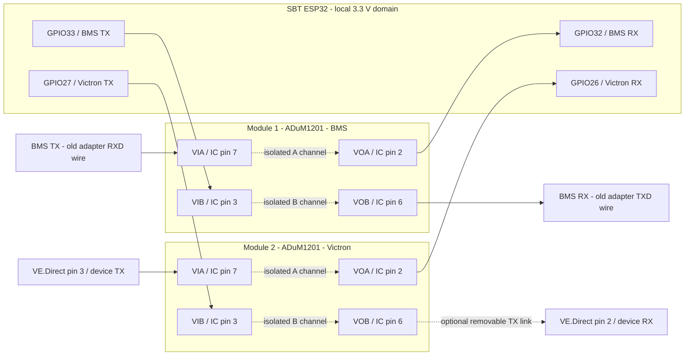

---
puppeteer:
  landscape: true
  format: "A4"
  printBackground: true
---

# SBT - Isolated BMS and Victron UART wiring

Date: 2026-10-17. Preparation drawing, not installed or tested. Two ADuM1201 modules replace the two ESP BLE transport paths later. This is the **SBT collector ESP**, not the separate SIL inverter controller. No firmware, device setting or control permission changes here.

## Proposed ESP connections

The repository builds `nodemcu-32s` on classic ESP32 and currently uses UART0 for USB diagnostics. Reserve the following GPIOs for the future UART implementation; the GPIO matrix allows explicit UART assignment. Confirm these labels are exposed and unused on the installed board before soldering. These assignments deliberately avoid GPIO16/17 and the flash/boot-strapping pins.

| Link | Proposed peripheral | ESP RX | ESP TX | Local power |
| --- | --- | --- | --- | --- |
| JBD BMS | UART1, explicitly remapped | GPIO32 | GPIO33 | ESP 3V3 / GND |
| SmartSolar MPPT 150/35 | UART2, explicitly remapped | GPIO26 | GPIO27 | ESP 3V3 / GND |
| USB diagnostics | UART0, unchanged | Existing RX0 | Existing TX0 | Existing board supply |

These are proposed wiring reservations, not active firmware defaults. [Espressif UART routing documentation](https://docs.espressif.com/projects/esp-idf/en/stable/esp32/api-reference/peripherals/uart.html).

## Signal diagram - both modules

Arrows show signal direction; dotted internal paths cross the isolation barrier. Power and ground connections are in the table below. There is **no ground or supply jumper across either module**.

## Connection table - match the photographed module labels

The photo labels side 1 `VDD1 / VOA / VIB / GND1` and side 2 `VDD2 / VIA / VOB / GND2`. Follow labels and verify continuity to the IC pins; do not infer orientation from wire colours or a rotated photograph.

| Module terminal | IC pin | Module 1: BMS | Module 2: Victron |
| --- | --- | --- | --- |
| VDD1 | 1 | ESP 3V3 | ESP 3V3 |
| VOA | 2 | ESP GPIO32, RX | ESP GPIO26, RX |
| VIB | 3 | ESP GPIO33, TX | ESP GPIO27, TX |
| GND1 | 4 | ESP GND | ESP GND |
| GND2 | 5 | BMS UART signal GND | VE.Direct pin 1, GND |
| VOB | 6 | BMS UART RX | VE.Direct pin 2, RX, via removable link |
| VIA | 7 | BMS UART TX | VE.Direct pin 3, TX |
| VDD2 | 8 | Qualified BMS-side logic supply; see below | VE.Direct pin 4, Power+, nominal 5 V on this MPPT |

ADuM1201 has one channel in each direction; ADuM1200 is not interchangeable here. Each side requires 2.7-5.5 V. Use 3.3 V on the ESP side. Confirm local 100 nF decoupling at each VDD/GND pair; the photograph appears to show capacitors but does not prove their value. Source: [Analog Devices ADuM1200/1201 datasheet, pin table on page 25 and layout guidance on page 28](https://www.analog.com/media/en/technical-documentation/data-sheets/ADuM1200_1201.pdf).

## Supplies and connector preparation

- Both VDD1/GND1 pairs share the ESP 3V3/GND. Keep each VDD2/GND2 pair with its own device. Do not connect ESP GND to either device-side ground through the new harness, shield or a non-isolated power adapter. Existing battery wiring may already link device grounds; do not add another bridge through this harness. The ADuM module transfers signals, not isolated power.
- Power the ESP independently from its suitable board supply. If that supply comes from the battery, it must preserve the intended isolation; an ordinary common-negative buck converter bridges it. Do not power the ESP from VE.Direct.
- On the conventional SmartSolar MPPT, VE.Direct is 5 V logic. Its power pin permits at most 10 mA average / 20 mA for 5 ms. Check the complete module load, including any LEDs, against that budget. [Victron interface FAQ](https://www.victronenergy.com/live/vedirect_protocol:faq).
- **BMS qualification is still required:** the original Bluetooth module being plugged into a UART does not establish its supply voltage, logic level or pin order. Use the owner-confirmed adapter label mapping below for signal identity, verify harness continuity, and measure supply and UART signal levels. Use a qualified device-side logic rail matched to its UART. A 5 V supply to the Bluetooth module does not prove 5 V TX/RX. If its power pin exceeds 5.5 V, never connect it to VDD2; a suitable device-side regulator/interface is needed. Never use pack voltage as logic power. Keep the BMS harness device end unconnected until identified.
- Prepare two labelled, keyed four-wire connectors with functional labels `device GND`, `device TX`, `device RX`, `device logic supply`. Their physical contact numbering remains your connector-specific drawing, not the BMS factory pinout. Use separate, clearly marked BMS and Victron connectors. Keep UART cables short and route each signal close to its own side's ground return. Solder/plug with power disconnected; avoid audio-style jacks that short contacts during insertion.

## Owner photo: four-contact UART adapter

The additional owner photo shows `GND / RXD / TXD / VCC` from left to right in the supplied image. This is a visual label order, not a proven mating-connector pin numbering. The owner confirmed this is the original **Bluetooth adapter**. Its RX/TX labels describe the adapter's perspective, giving the following confirmed signal mapping:

| Existing adapter contact label | Wire function at the BMS | New BMS isolator connection |
| --- | --- | --- |
| GND | BMS UART signal ground | GND2 |
| RXD | BMS TX -> adapter RXD | VIA |
| TXD | Adapter TXD -> BMS RX | VOB |
| VCC | Adapter supply from BMS; voltage unmeasured | VDD2 only after supply and UART logic qualification |

Preserve the existing harness contact assignment and trace each connector wire by continuity; a view of the mating face can reverse the apparent order. This photo resolves visible labels but does not establish supply voltage, signal amplitude or baud rate.
## Victron connector and first receive-only stage

The documented VE.Direct pin numbers are 1 GND, 2 device RX, 3 device TX, 4 Power+. Connector-face and cable-side views are mirrored; verify pin 1 from the manufacturer's drawing and continuity before terminating a cable. The protocol is 19200 baud, 8 data bits, no parity, 1 stop bit, no flow control. See [VE.Direct protocol, physical interface and serial configuration](https://www.victronenergy.com/upload/documents/VE.Direct-Protocol-3.34.pdf).

Prepare the TX wire but initially leave the removable link between module VOB and Victron RX open for TEXT receive-only operation. Hold unused module VIB at local 3V3 through a proposed 10 kOhm pull-up if the ESP pin is not driven; do not leave it floating. Confirm Victron TX/RX are configured for serial communication, not alternate PWM or remote-control functions, before later enabling the TX link. A wired TX path is not permission to send configuration commands.

For BMS polling, both directions are eventually needed. Disconnect the original Bluetooth UART adapter before connecting ESP TX to the BMS RX; do not parallel two active transmitter outputs. The actual BMS baud/framing must be identified, not inferred from BLE data. Retain the current JBD decoder, command ownership and permission semantics when changing transport later.

## What is ready and what remains

Ready: ESP-side pin proposal, both isolation-module connections, labelled harness preparation, and separate device-side supplies. Pending before energizing: actual board pin availability, BMS connector/logic supply/baud, VE.Direct orientation/mode and module inspection. No Wokwi simulation is claimed to validate galvanic isolation or the physical BMS interface. Export this Mermaid Markdown through the existing Markdown Preview Enhanced PDF workflow if desired.

Later acceptance compares telemetry stability, sample age, free/minimum heap, stack headroom and cycle time. Disabling BLE at runtime and removing its stack from a build are different changes; resource savings remain measured acceptance results.
