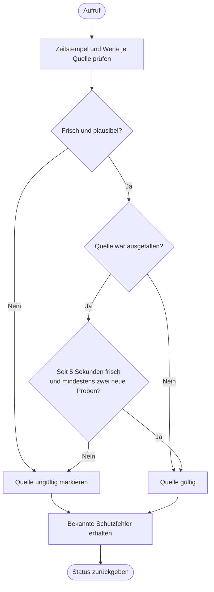

---
puppeteer:
  landscape: true
  format: "A4"
  printBackground: true
---

# SIL – Frische und Plausibilität prüfen

Stand: 16.10.2026, Runde 3. Grober Diskussionsentwurf, keine Freigabe zur Umsetzung.

**Ein- und Ausgang:** Messwerte mit Zeitstempeln und Herkunft → Gültigkeit je Quelle, bekannte Fehler und Wiederanlaufstatus.

**Formen:** Rechteck = Anweisung; doppelte Seitenlinien = Unterprogramm; Raute = Entscheidung; abgerundet = Start/Ende.

## Annahmen und offene Punkte

5 Sekunden sind eine feste Code-Konstante, keine Einstellung. Wiederholte alte MQTT-Werte gelten nicht als neue Proben. Ungültig ist nicht gleich null. Frischegrenzen pro Quelle und zulässige Wertebereiche müssen vor Umsetzung festgelegt werden; dieser Baustein entscheidet noch keinen MAX- oder Einlagerungsmodus.
