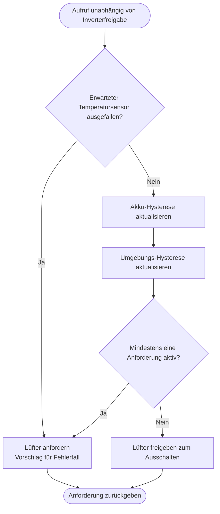

---
puppeteer:
  landscape: true
  format: "A4"
  printBackground: true
---

# SIL – Lüfterbedarf aus Akku- und Umgebungstemperatur bestimmen

Stand: 16.10.2026, Runde 3. Grober Diskussionsentwurf, keine Freigabe zur Umsetzung.

**Ein- und Ausgang:** Akkutemperatur, BME280-Temperatur, Gültigkeit und interne Einstellungen → Lüfteranforderung.

**Formen:** Rechteck = Anweisung; doppelte Seitenlinien = Unterprogramm; Raute = Entscheidung; abgerundet = Start/Ende.

## Annahmen und offene Punkte

Je Sensor: EIN ab Schwelle, AUS unter Schwelle minus Hysterese; dazwischen vorherigen Zustand halten. Diskussionswerte: Akku 40 °C / Hysterese 3 K, Umgebung 35 °C / 3 K. Keine qualifizierten Batterieschutzgrenzen. Bei 35–40 °C im Schuppen ist Dauerlauf möglich. Schutzbedarf soll manuelles AUS überstimmen (Vorschlag). Unabhängig vom BME-Abfrageintervall arbeiten; unbestückte Sensoren nicht als ausgefallen behandeln.
