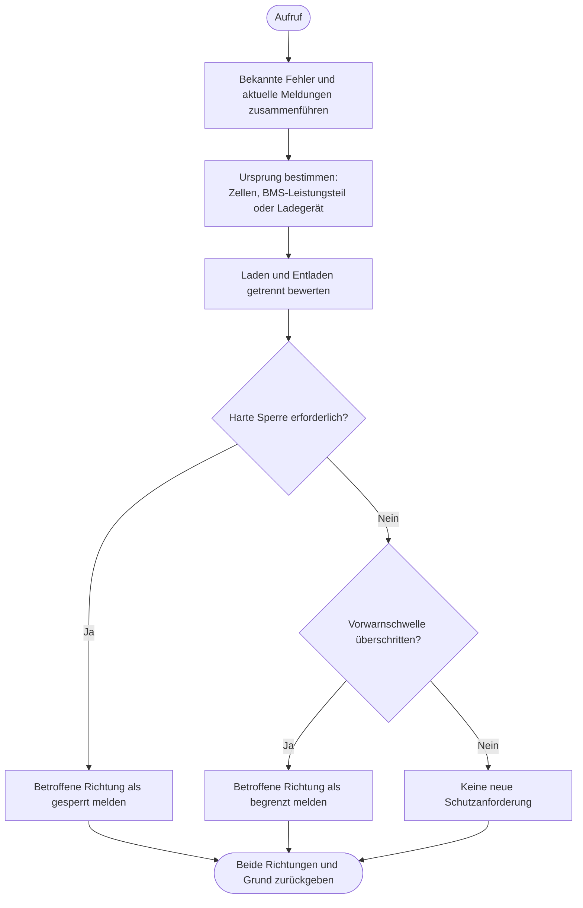

---
puppeteer:
  landscape: true
  format: "A4"
  printBackground: true
---

# SIL – Richtungsabhängige Schutzprüfung

Stand: 16.10.2026, Runde 3. Grober Diskussionsentwurf, keine Freigabe zur Umsetzung.

**Ein- und Ausgang:** Gültige BMS- und Victron-Meldungen, Temperaturherkunft, Zellwerte und Stromrichtung → richtungsbezogene Schutzanforderungen.

**Formen:** Rechteck = Anweisung; doppelte Seitenlinien = Unterprogramm; Raute = Entscheidung; abgerundet = Start/Ende.

## Annahmen und offene Punkte

Beide Richtungen können gleichzeitig betroffen sein. BMS-Schutz bleibt eigenständig; SIL darf ihn nicht umgehen. Lade- und Entladegrenzen sowie Hysteresen sind getrennt zu qualifizieren. Ein Telemetrieverlust löscht keine bekannte Sperre. Entsperren erfordert gültige Rückmeldung und erfüllte Freigabebedingungen. Fehlerzuordnung und genaue Schwellen sind offen.
