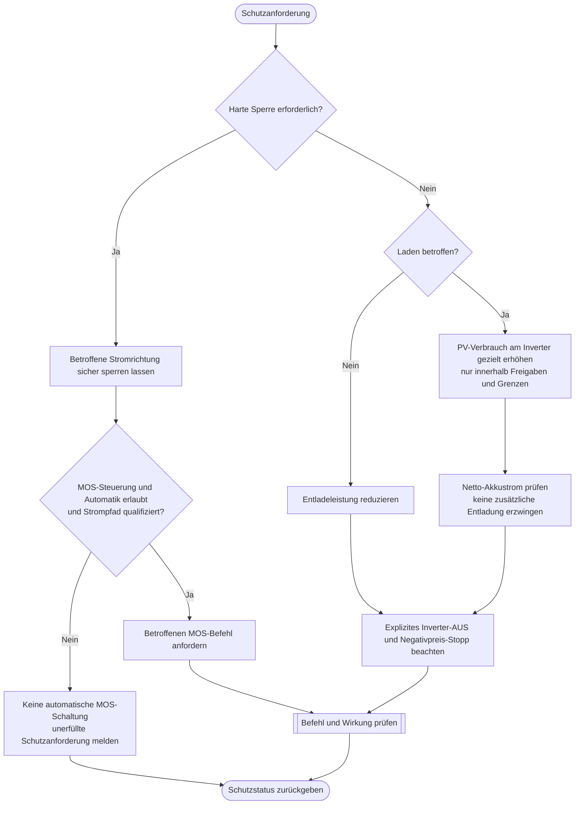

---
puppeteer:
  landscape: true
  format: "A4"
  printBackground: true
---

# SIL – Laden oder Entladen begrenzen oder sperren

Stand: 16.10.2026, Runde 3. Grober Diskussionsentwurf, keine Freigabe zur Umsetzung.

**Ein- und Ausgang:** Richtungsbezogene Anforderungen, Freigaben und Messwerte → begrenzter Sollwert, zulässige MOS-Anforderung und Ergebnis.

**Formen:** Rechteck = Anweisung; doppelte Seitenlinien = Unterprogramm; Raute = Entscheidung; abgerundet = Start/Ende.

## Annahmen und offene Punkte

Bei gleichzeitigen Anforderungen den strengeren zulässigen Betrieb bestimmen; niemals Laden gegen Entladeschutz ausspielen. Der vorhandene BMS-Eigenschutz muss unabhängig wirksam bleiben. Inverter 0 W verhindert PV-Ladung nicht. Eine fehlende MOS-Berechtigung darf deshalb nicht als erfolgreich ausgeführte Ladesperre gelten. Wie PV bei gesperrter Batterie sicher weiterläuft, ist hardwareseitig offen. Ladegerät-Stopp und weitere Rückfallebenen sind erst zu qualifizieren.
