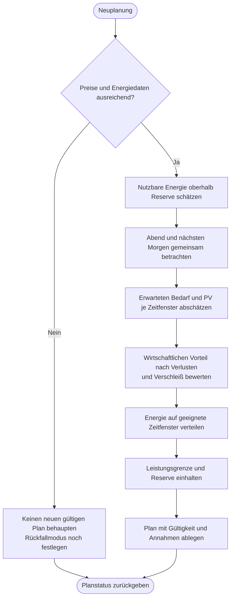

---
puppeteer:
  landscape: false
  format: "A4"
  printBackground: true
---

# SIL – Energie über Abend und Morgen verteilen

Stand: 16.10.2026, Runde 3. Grober Diskussionsentwurf, keine Freigabe zur Umsetzung.

**Ein- und Ausgang:** Preise, SOC, Reserve, erwartete Last und verfügbare PV-Prognose → Energieanteile pro Zeitfenster.

**Formen:** Rechteck = Anweisung; doppelte Seitenlinien = Unterprogramm; Raute = Entscheidung; abgerundet = Start/Ende.

## Annahmen und offene Punkte

Vorschläge: 36 Stunden Horizont, Neuplanung alle 30 Minuten oder bei wesentlicher Änderung; aktuelle 15-Minuten-Preise trotzdem rechtzeitig anwenden. Planungsgrundlast zunächst 650 W. Ohne PV-Prognose keine sichere künftige Ladung versprechen. Ausgewogene Versorgung gegenüber reiner Preisspitzenoptimierung bleibt Diskussionspunkt. Bereits gespeicherte Energie nicht erneut mit vergangenen Ladeverlusten belasten. Reserve 5 % plus 3 Prozentpunkte Hysterese ist ein Vorschlag, keine Zellschutzgrenze.
