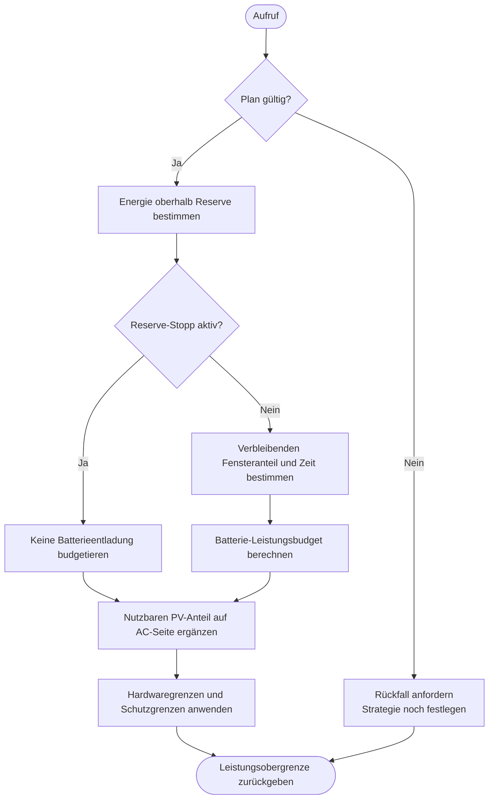

---
puppeteer:
  landscape: true
  format: "A4"
  printBackground: true
---

# SIL – Aktuelles Energiebudget und Leistungsobergrenze berechnen

Stand: 16.10.2026, Runde 3. Grober Diskussionsentwurf, keine Freigabe zur Umsetzung.

**Ein- und Ausgang:** Gültiger Plan, verbleibende Energie und Dauer des Unterstützungsfensters, aktuelles PV-Angebot → aktuelle AC-Leistungsobergrenze.

**Formen:** Rechteck = Anweisung; doppelte Seitenlinien = Unterprogramm; Raute = Entscheidung; abgerundet = Start/Ende.

## Annahmen und offene Punkte

AC-Batteriebudget näherungsweise: zugeteilte verbleibende kWh × 1000 / verbleibende Stunden. Reserve-Stopp setzt bei Reserve und löst bei Reserve plus Hysterese. Keine Division durch null; fehlende Planzeit ist kein unbegrenztes Budget. Beispiel: (15 % − 5 %) × 6,74362 kWh × 0,90 / 1,5 h ≈ 405 W Batterie; mit angenommenen 24 W PV auf AC-Seite ≈ 429 W. Nicht durch den gesamten 36-Stunden-Horizont teilen. Positive MIN darf bei fehlender PV keine Reserveentladung erzwingen; finale PV-/MIN-Regel offen.
