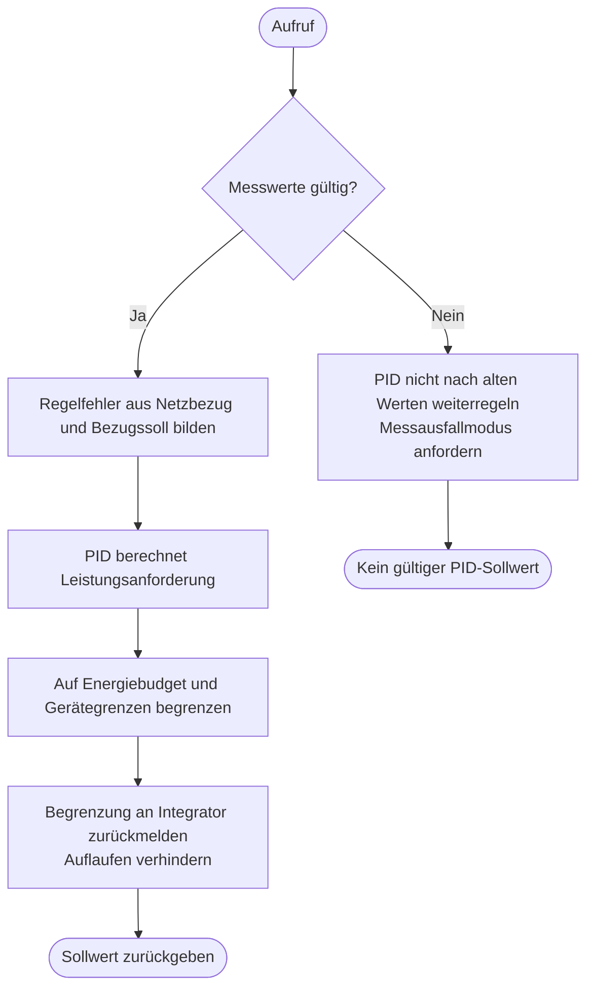

---
puppeteer:
  landscape: true
  format: "A4"
  printBackground: true
---

# SIL – Netz-PID berechnet Leistung für den Hausbedarf

Stand: 16.10.2026, Runde 3. Grober Diskussionsentwurf, keine Freigabe zur Umsetzung.

**Ein- und Ausgang:** Gültige Netz- und Inverterleistung, Bezugssoll und zulässige Leistungsgrenzen → angeforderte Inverterleistung.

**Formen:** Rechteck = Anweisung; doppelte Seitenlinien = Unterprogramm; Raute = Entscheidung; abgerundet = Start/Ende.

## Annahmen und offene Punkte

PID korrigiert den aktuellen Netzbezug. Er verteilt keine Energie über Abend und Morgen. 650 W ist eine Planungsannahme und kein fester PID-Sollwert. Vorzeichen und Reglerausgang müssen an den bestehenden SIL-Regler angepasst werden. Bei Inverter-AUS, MAX-Bypass oder Schutzmodus Integrator passend nachführen; ruckfreie Rückkehr ist zu prüfen. Der gezeigte Begrenzungsschritt entspricht der Begrenzung nach dem PID im Hauptablauf.
