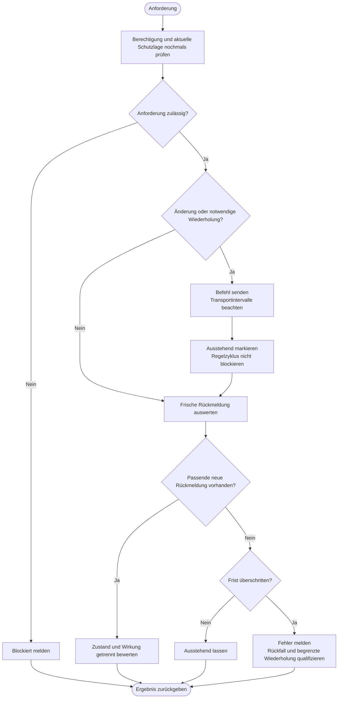

---
puppeteer:
  landscape: true
  format: "A4"
  printBackground: true
---

# SIL – Sollwert senden und tatsächliche Wirkung prüfen

Stand: 16.10.2026, Runde 3. Grober Diskussionsentwurf, keine Freigabe zur Umsetzung.

**Ein- und Ausgang:** Zulässiger Sollwert bzw. freigegebener MOS-Befehl → bestätigter, ausstehender oder fehlgeschlagener Zustand.

**Formen:** Rechteck = Anweisung; doppelte Seitenlinien = Unterprogramm; Raute = Entscheidung; abgerundet = Start/Ende.

## Annahmen und offene Punkte

Eine Transportbestätigung ist keine bestätigte MOS-Stellung. MAX ist nur eine Anforderung, keine garantierte Leistung. Tatsächliche AC-Leistung hängt auch von PV, Batterie und Inverter ab. Schwankende ESP-Rücklesung ist derzeit akzeptiert; automatische MOS-Wiederholungen sind damit noch nicht qualifiziert. Fristen und Wiederholungsgrenzen sind Protokolldetails, nicht neue Benutzereinstellungen.
