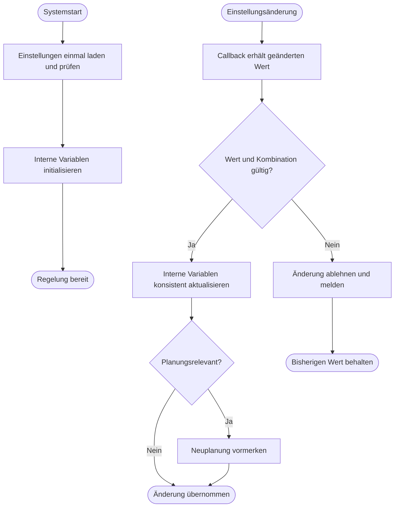

---
puppeteer:
  landscape: true
  format: "A4"
  printBackground: true
---

# SIL – Einstellungen beim Start und per Callback übernehmen

Stand: 16.10.2026, Runde 3. Grober Diskussionsentwurf, keine Freigabe zur Umsetzung.

**Ein- und Ausgang:** Start bzw. Änderung einer Einstellung → gültige interne Variablen und gegebenenfalls Neuplanungsanforderung.

**Formen:** Rechteck = Anweisung; doppelte Seitenlinien = Unterprogramm; Raute = Entscheidung; abgerundet = Start/Ende.

## Annahmen und offene Punkte

Im Regelzyklus weder Einstellungen aus NVS laden noch JSON-Konfiguration abfragen. Er nutzt die bereits vorhandenen internen Variablen. Persistenz gehört zur Einstellungsverwaltung. Vorschlag: Callback kurz halten und aufwendige Neuplanung nur vormerken; bei nebenläufigen Callbacks eine konsistente Übergabe sichern. Sperren müssen spätestens vor dem nächsten Befehl wirksam sein. Kurze interne bzw. JSON-Namen wie mosAuto bleiben möglich; verständliche HA-Beschriftungen sind davon unabhängig.
