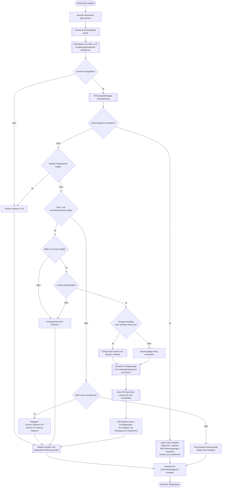

---
puppeteer:
  landscape: true
  format: "A4"
  printBackground: true
---

# SIL - Ablaufdiagramm für die gemeinsame Diskussion

Stand: 16.10.2026, Runde 3. Entwurf, keine Freigabe zur Umsetzung.

Die frühere PDF zeigt den vorherigen Diskussionsstand. Diese Markdown-Datei ist die überarbeitete Quelle; nach Änderungen bitte neu als PDF exportieren.

Einstellungen werden beim Start einmal geladen. Änderungen aktualisieren interne Variablen per Callback; der Regelzyklus nutzt diese Variablen ohne erneutes Laden der Einstellungen. Siehe Unterprogramm 09.

**Formen:** Rechteck = Anweisung; doppelte Seitenlinien = Unterprogramm; Raute = Entscheidung; abgerundet = Start/Ende.

## Beispiel für die Diskussion

15 % SOC, 1.358 W Hausbedarf, 27 W PV; Preis 0,39 EUR/kWh, später 0,42 EUR/kWh. Mit angenommenen 6,74 kWh nomineller Kapazität, 5 % Reserve, 90 % Entladewirkungsgrad und einer gewünschten Versorgungsdauer von 1,5 Stunden ergibt sich ungefähr 430 W Inverterleistung. Diese Annahmen sind keine gemessene Laufzeitgarantie. 900 W würden den so berechneten Vorrat in ungefähr 42 Minuten aufbrauchen, 450 W in ungefähr 85 Minuten.

## Offene Gesprächspunkte

- Energie möglichst gleichmäßig über teure Stunden verteilen oder stärker auf die teuerste Spitze konzentrieren?
- Wirtschaftliche Reserve und Hysterese; tatsächliche nutzbare Kapazität und SOC-Verlässlichkeit.
- Richtungsspezifische Schutzreaktionen und nachgewiesene Strompfade bei geöffneten MOS.
- Verhalten beim gleichzeitigen Verlust von BMS-, Netz- und Invertermesswerten.
- Automatische PV-Nutzung ohne saisonales Nachstellen; endgültige MIN-Einstellung.

Die wirtschaftliche Planung wird im MAX-Bypass umgangen. Eine Schutzreaktion darf explizites Inverter-OFF nicht unbemerkt aufheben. Die Schutz-Unterprogramme sind noch auszuarbeiten; das Diagramm beschreibt keine bereits implementierte Automatik.

## Unterprogramme und Druckanleitung

- [Frische und Plausibilität prüfen](01-messwerte.md)
- [Lüfterbedarf aus Akku- und Umgebungstemperatur bestimmen](02-luefter.md)
- [Richtungsabhängige Schutzprüfung](03-schutzpruefung.md)
- [Laden oder Entladen begrenzen oder sperren](04-schutzreaktion.md)
- [Energie über Abend und Morgen verteilen](05-energieplanung.md)
- [Aktuelles Energiebudget und Leistungsobergrenze berechnen](06-energiebudget.md)
- [Netz-PID berechnet Leistung für den Hausbedarf](07-netz-pid.md)
- [Sollwert senden und tatsächliche Wirkung prüfen](08-senden-ruecklesen.md)
- [Einstellungen beim Start und per Callback übernehmen](09-einstellungen-callback.md)

[PDF selbst erstellen](README.md#selbst-als-pdf-ausgeben)
